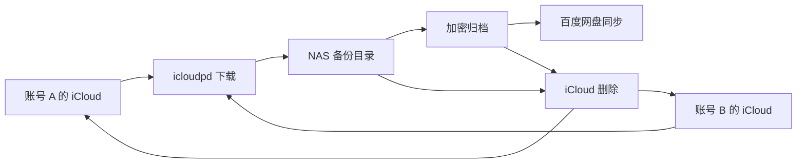

# 设计方案

本文档记录工具的需求、总体设计和待确认事项。
待确认事项定下来之后再开始编码。

## 背景

两个家庭成员共用一个 2 TB 的 iCloud 家庭方案，两个账号都由云上贵州运营。
多年前的照片一直留在 iCloud 里，占着空间。
NAS 运行 fnOS，照片放在 4 TB RAID1 阵列 `/vol2`，其他资料放在 16 TB RAID1 阵列 `/vol3`。

## 范围

本版做下列三件事：

- 把多个 iCloud 账号的照片和视频备份到 NAS，各账号分开存放
- 定期把备份打包成加密归档，作为第二份副本，由用户设置的百度网盘目录同步上传
- 从 iCloud 删除已经备份的照片，有两份副本的早期照片自动删除，其他删除由用户确认

下列功能本版不做，以后需要时再加：

- 跨账号去重与合并
- 按人脸分类
- 相册归属的保存
- 共享图库的备份

## 总体结构



工具由一个 Python 后端和一个网页界面组成，状态记录在 SQLite 数据库里。
最终打包成 fnOS 的 Docker 应用，在 NAS 上运行。

## 备份

iCloud 访问使用 icloudpd 1.32.3 自带的 `pyicloud_ipd` 库，icloudpd 采用 MIT 许可证，支持中国大陆的 iCloud 域名。
工具不调用 icloudpd 命令行，而是直接调用这个库来登录、列出照片、下载和删除，这样才能记下每张照片对应的每个文件，供删除前校验。
PyPI 上平台专用的 icloudpd 轮子只含打包好的可执行文件，所以 `pyproject.toml` 固定使用它的纯 Python 轮子，升级前先测试。

每张照片下载下列文件：

- 原图
- RAW+JPEG 照片中的另一份
- 编辑版，只在和原图不同时下载
- Live Photo 的视频部分
- 用 icloudpd 的 XMP 生成逻辑导出的 XMP 文件，包含收藏、标题、关键字和 GPS

隐藏相簿里的照片不在列表里，不会备份，也不会被删除。

备份目录的结构如下：

```text
Photos/iCloud/
├── 账号 A/2023/05/
├── 账号 A/unknown/
└── 账号 B/2023/05/
```

月份按北京时间的拍摄日期计算，没有拍摄日期的照片放在 `unknown` 目录。
文件名沿用 iCloud 里的原始文件名，同一张照片的各个文件使用相同的前缀：

| 文件       | 文件名示例            |
| ---------- | --------------------- |
| 原图       | IMG_0001.HEIC         |
| 编辑版     | IMG_0001-adjusted.JPG |
| Live Photo | IMG_0001.MOV          |
| XMP        | IMG_0001.HEIC.xmp     |

同一个月里出现同名文件时，后来的照片在前缀后面加上由照片编号生成的 8 位后缀。
文件先写到同目录下以点开头的临时文件，大小与 iCloud 记录一致后才改成正式文件名，文件修改时间设为拍摄时间。

备份按计划定时增量运行，也可以在界面上手动触发。
备份目录只增不减，iCloud 里删掉的照片不会从 NAS 上删掉。
工具记录每张照片的 iCloud 记录编号、拍摄日期、应有的文件，以及每个文件的路径、大小和 SHA-256。
每次同步开始时，工具先用 iCloud 的计数索引查询账号的照片总数和视频数，一次请求就能得到，备份进度以这个总数为分母。
视频和照片一起备份，界面上单独列出视频的数量；实况照片的视频部分算作照片的附属文件。

Apple ID 密码只在登录时输入，不保存，登录后的会话文件放在状态目录里。
会话过期后，界面显示需要登录，用户重新输入密码和双重认证验证码。
其他家庭成员账号的验证码由账号主人发给用户，用户在界面里输入。
两个账号都要打开“在网页上访问 iCloud 数据”，并且不能开启高级数据保护。

## 归档备份

工具定期把备份目录按“账号、年、月”打包，每个月一个 7z 包，放进归档目录。
用户在飞牛的百度网盘应用里把归档目录设为同步目录，由百度网盘负责上传。

打包使用下列规则：

- 使用 AES-256 加密，文件名也加密，密码在界面上设置一次，之后不能修改，只存放在状态目录里
- 照片和视频本身已经压缩过，所以只存储、不再压缩，以节省 NAS 的 CPU
- 百度网盘对单个文件的大小有限制，具体上限取决于会员等级，所以包按可配置的大小分卷，默认 3900 MB
- 只打包已经结束的月份，当月的照片下个月再打包，没有拍摄日期的照片单独打成一个包
- 某个月的备份内容变了，就重新打包这个月

包按 `账号/年/账号-年-月-v版本号.7z.001` 命名，例如 `clow/2023/clow-2023-05-v1.7z.001`。
新包先在暂存目录里生成，用密码解开整个包，逐个核对文件的路径、大小和 SHA-256。
校验通过后，新包移进归档目录并登记，然后才删除同一个月的旧版本。
工具不会删除归档目录里的其他文件。
恢复时用 7-Zip 和归档密码解开第一个分卷即可。

归档目录放在 `/vol3`，这样第二份副本和备份目录不在同一组硬盘上。
用户确认，`/vol3` 上校验通过的归档包就算第二份副本。
百度网盘上的那份是额外的异地副本，工具不检查它是否上传完成。

## iCloud 删除

一张照片满足下列全部条件，才算备份完成：

- NAS 上的原图文件存在，大小与 iCloud 记录一致
- 有编辑版的照片，编辑版也已经备份
- Live Photo 的视频部分也已经备份
- 照片有拍摄日期

备份完成、并且所在月份的归档包校验通过，才算有两份副本。

自动删除只处理同时满足下列条件的照片：

- 拍摄日期早于 2 年前，年限可以在界面上修改
- 有两份副本

自动删除按计划定时运行，每一轮的数量有上限。
第一次运行时只生成删除报告，不真正删除，用户确认报告无误后再开启自动删除。

其他删除都要用户确认。
用户在界面上选择账号，按拍摄月份勾选要清理的范围，工具列出所选月份的照片，逐张标出备份状态和副本数量。
只有备份完成的照片才能删除，只有一份副本的照片在清单里单独提示。
用户确认清单之后，工具才执行删除。

删除的方式和 icloudpd 的 Move 模式相同，只把 iCloud 记录标记为已删除。
删掉的照片会进入“最近删除”，30 天内可以恢复。
icloudpd 自带的 `--keep-icloud-recent-days`、`--auto-delete` 和 `--delete-after-download` 都不用。
每张被删除的照片都写进日志，日志注明是自动清理还是人工删除。

## 界面

界面按桌面应用的方式布局，左侧是导航和账号列表，右侧是内容，底部状态栏显示当前任务和下次运行时间。
窗口整体不滚动，表格和列表在各自的区域内滚动。

界面分为下列几部分：

- 总览：显示 iCloud 占用、备份进度、两份副本比例、可释放和已释放的空间，在“数量统计”中按拍摄年份分别显示 iCloud 中的照片和视频数量，以及已从 iCloud 删除的数量，并列出归档密码、登录、同步、归档和磁盘剩余空间等运行状况
- 添加账号：在对话框中依次填写账号信息、Apple ID 密码和双重认证验证码，中途取消会删除还没登录的账号
- 账号：按月显示照片数量、备份和归档状态，可以重新登录和改名
- 空间清理：人工删除和自动清理共用一张月份表，表中标出每个月可以删除的照片和符合自动清理规则的照片；勾选月份后核对清单并确认删除，也可以修改自动清理规则和查看下一轮的清单
- 日志：操作记录、任务和删除记录三个视图，操作记录保存添加账号、登录、改名、修改规则和设置、手动启动任务、人工删除等操作，以及操作人
- 设置：归档密码、运行间隔和分卷大小

## 部署

后端使用 Python 3.13 和 FastAPI，依赖用 uv 管理，页面由服务端用 Jinja2 模板生成，不依赖前端框架。
同一时间只运行一个任务，定时任务默认每 24 小时完整运行一轮，间隔可以在界面上修改。
按月统计在照片多、NAS 忙的时候要算几秒，所以结果缓存在内存里：超过 60 秒先显示旧结果并在后台重算，任务结束后立即失效。
路径和监听方式都由环境变量配置，`VAULT_SOURCE=fake` 使用模拟照片库，用于开发和演示。

### fnOS 应用包

应用包的源文件在 `fnos/` 目录，`scripts/build-fpk.sh` 构建 x86_64 镜像，导出后放进应用包，再用 fnpack 打成 fpk。
NAS 不一定能访问镜像仓库，所以镜像随应用包分发，由生命周期脚本用 `docker load` 导入。
应用中心在 `install_callback` 和 `upgrade_callback` 之前就会启动容器，所以镜像导入和目录准备放在 `install_init` 和 `upgrade_init` 阶段。
这时应用文件还没放进安装目录，脚本到安装包的解压目录里找镜像，必要时直接从 `app.tgz` 里流式导入。
应用安装到系统分区，生命周期脚本以 root 运行，因为它们要导入镜像、在用户目录下创建文件夹并设置属主。
容器以 root 启动，绑定网关的 Socket 并把属主设为 NAS 的第一个用户之后，立即降权到这个用户和 Users 组，也就是 1000:1001。
备份出来的照片属于这个用户，文件管理器和飞牛相册都能正常访问。

### 访问控制

应用只通过统一网关访问，不开放任何端口：

- 网关路径是 `/app/icloud-photo-vault`，fnOS 先确认用户已登录 NAS，再把请求转发到应用目录下的 `app.sock`
- 服务只接受带有 `X-Trim-Isadmin: true` 请求头的请求，非管理员看到的是 403
- 桌面入口只对管理员显示
- `app.sock` 在服务开始监听之前就设为 0600，只有 UID 为 1000 的用户和以 root 运行的网关能连接，其他本地用户无法绕过网关伪造请求头
- 已在 NAS 上验证，没有登录 NAS 的请求即使带上管理员请求头，也会被网关以 `invalid token` 拒绝，不会到达应用

### NAS 上的目录

| 用途               | 路径                                       |
| ------------------ | ------------------------------------------ |
| 备份目录           | /vol2/1000/Photos/iCloud/                  |
| 归档目录           | /vol3/1000/4-Archives/icloud-photo-vault/  |
| 数据库、会话与密码 | /vol3/1000/4-Archives/.icloud-photo-vault/ |

账号目录用账号主人的名字命名。
目录不存在时由安装脚本创建，属主设为 1000:1001，已有目录保持不变。
数据库、会话文件、归档密码和暂存目录放在归档目录旁边的隐藏目录里，权限为 700。
它们不放在应用自己的数据目录里，因为卸载或重装应用时那里会被清掉，而丢失数据库会导致所有照片被当成新文件重新下载。
隐藏目录和归档目录在同一个存储空间，生成好的包可以直接移进归档目录。
卸载应用只移除镜像，备份、归档、数据库和归档密码都保留。

## 后续合并功能的预留

各账号的备份目录作为原始层保持不变，以后的合并功能在原始层之上另建合并后的照片库。
合并库和备份目录都在 `/vol2` 上，可以用硬链接引用原始文件，不占额外空间。
数据库里的照片记录从一开始就带上账号和 SHA-256，合并时直接按哈希找出重复照片。

## 风险

- icloudpd 依赖苹果未公开的网页接口，苹果修改接口后可能暂时无法使用，而且这个项目正在寻找新的维护者
- 归档包是加密的，丢了密码就无法恢复，密码要另外妥善保存
- 7-Zip 读取加密包时只能从命令行参数接收密码，所以打包和校验期间，密码会出现在进程列表里，NAS 上能查看所有进程的用户可以看到
- 应用包里的目录、UID 和 GID 是按作者的 NAS 写死的，换机器或换用户时要改 `fnos/app/docker/docker-compose.yaml` 和 `fnos/cmd/common`
- 百度网盘应用如果设成双向同步，网盘端的误删会同步回 NAS，应该设成单向上传

## 后续工作

1. 从 fnOS 桌面打开应用，确认网关转发后的界面和操作正常
2. 用真实账号做第一次备份和删除报告，确认 iCloud 返回的数据与测试一致
